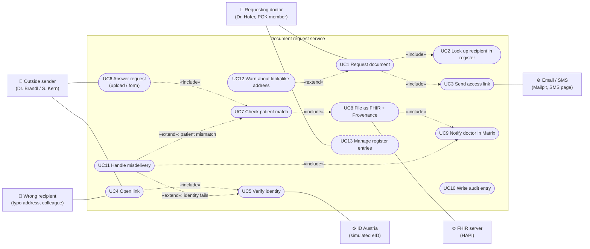
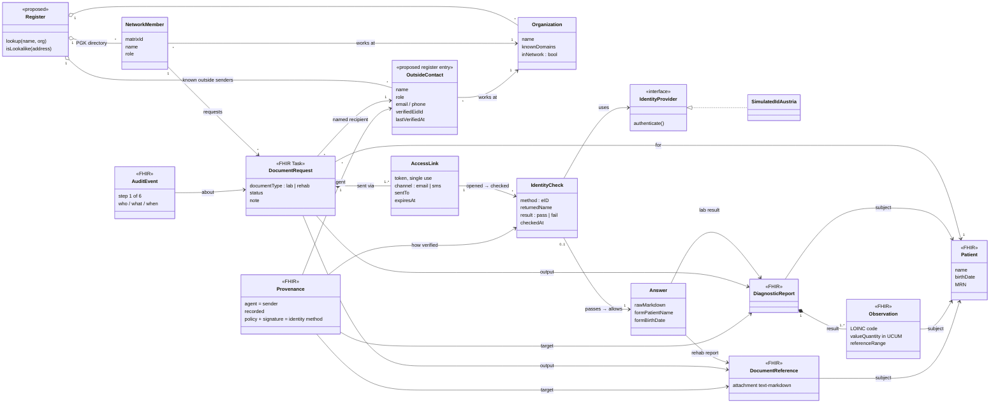
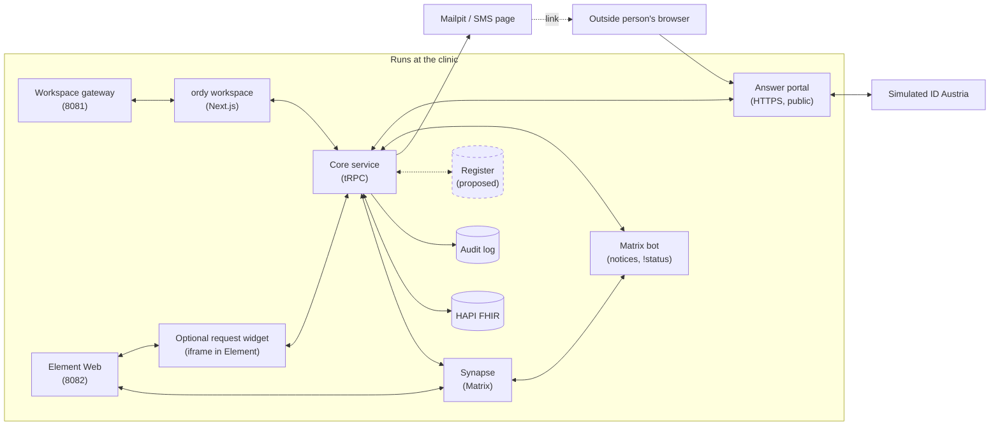

# UML: current use case and relations

These diagrams model the target system from [`track/README.md`](../track/README.md) and [WHITEPAPER.md](WHITEPAPER.md). The [README status](../README.md#status) says which parts run.
Dashed elements are **proposed** and not built: managing register entries (UC13) and the register itself. Add comments as `> 💬 Name: ...`.

## 1. Use case diagram

UC10 (audit) is included by UC3, UC4, UC5, UC6, UC8 and UC11. The diagram leaves those six edges out to stay readable. They are the six audit steps the jury counts.

| Use case | Actor | Covers |
|---|---|---|
| UC1 Request document | Dr. Hofer | Request form in the ordy workspace: patient, document type, named recipient, contact |
| UC3 Send access link | – | One-time link. No patient name, birth date or document type in the email or SMS |
| UC5 Verify identity | Sender, ID Austria | eID name must equal the named recipient → catches **M1, M2** |
| UC7 Check patient match | – | Patient in the document and form must equal the request's patient → catches **M3** |
| UC8 File as FHIR | FHIR server | Transaction Bundle: DiagnosticReport + Observations or DocumentReference, plus Provenance |
| UC11 Handle misdelivery | – | Nothing filed, audit entry, warning in Matrix |
| UC2 Look up recipient in register | Dr. Hofer, eHVD | Built on the eHVD as the directory search in the workspace's Contacts view and the recipient check while she types a new request |
| UC12 Warn about lookalike address | Dr. Hofer, eHVD | Built as the address check before sending (T15). A domain that differs from the organisation's `mail` domain in the eHVD, such as `labor-kanaI`, waits for **Send anyway** → helps catch **M1** |
| UC13 Manage register entries | Dr. Hofer | *Proposed*, see section 4 |

## 2. Domain relations (class diagram)

## 3. Component relations

## 4. The register: open questions

The track says outside people are **in no directory**. The PGK directory only lists network members. So our register would be the clinic's own address book of outside contacts, not a public directory.

| Question | Proposal | Your input |
|---|---|---|
| R1 What does the register hold? | PGK members (read from the directory), known outside contacts, and organisations with their known email domains | |
| R2 Who adds outside contacts? | Dr. Hofer on her first request (name + contact). The entry gets "verified" after the first successful eID check | |
| R3 What does ID Austria give us? | Name + birth date, plus an eID identifier (bPK-like). We store the identifier so later answers must come from the same person, not just the same name | |
| R4 Lookalike detection | Compare the typed address against known domains (`labor-kanaI` vs `labor-kanal`) → warning before sending (helps M1) | |
| R5 Is this in scope for the demo? | Minimal version: a seeded JSON file or a Postgres table, no admin UI | |

> 💬 Add further information here.
